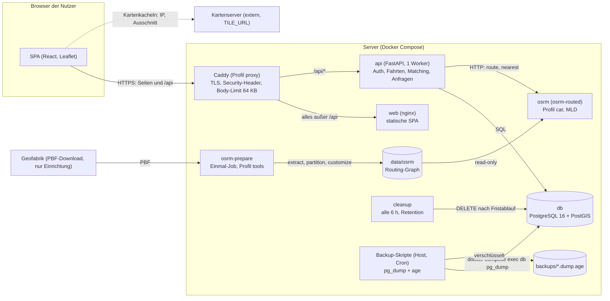

# Mitfahrer-Matching für den 40C3

Selbst gehostete, rein Open-Source-basierte Webanwendung: Fahrer legen eine Fahrt zum Kongress an, Mitfahrer
geben ihren Abholpunkt auf der Karte an und bekommen passende Fahrten angezeigt. Maßgeblich ist der **reale
Umweg** (OSRM), nicht die Luftlinie. Kontaktdaten (E-Mail) werden erst nach beidseitiger Bestätigung freigegeben,
alle Daten werden nach der Veranstaltung automatisch gelöscht.

> **Stand (2026-11-11):** Funktionsumfang der Phasen 1–7, die E2E-Tests und die Dokumentation sind integriert, das CI auf `main`
> ist grün, die **Abnahme** in einem frischen Klon ist bestanden (Ablauf, Zahlen und Grenzen: „Phase 8, Teil Abnahme“ in
> [`PLAN.md`](PLAN.md)). **Nicht betriebsbereit für echte Nutzer**, solange die Platzhalter für Datenschutz,
> Impressum, Ort und Datum des Kongresses sowie die Kartenserver-Frage offen sind (Abschnitt
> [Bekannte Grenzen und offene Punkte](#bekannte-grenzen-und-offene-punkte)).

**Weiterführende Dokumente:** [`PLAN.md`](PLAN.md) (Phasen, Annahmen, offene Fragen) ·
[`docs/API-CONTRACT.md`](docs/API-CONTRACT.md) (verbindlicher API-Vertrag) ·
[`docs/DATENSCHUTZ.md`](docs/DATENSCHUTZ.md) (Entwurf einer Datenschutzerklärung, **kein Rechtsrat**) ·
[`deploy/hel/README.md`](deploy/hel/README.md) (Betrieb auf Proxmox) · [`web/README.md`](web/README.md) (Frontend) ·
[`e2e/README.md`](e2e/README.md) (End-to-End-Tests) · [`CLAUDE.md`](CLAUDE.md) (Übergabe für Coding-Agenten).

**Nachweis-Kennzeichnung.** Aussagen über Messwerte und Prüfungen tragen, wo es darauf ankommt, eine Quelle:
**[A]** in der Dokumentationsrunde am 2026-11-11 selbst ausgeführt (macOS arm64, Docker über Colima, Hamburg-Extrakt) ·
**[T]** durch automatische Tests oder CI belegt · **[P]** Befund aus einer früheren Prüfrunde übernommen, hier **nicht**
erneut ausgeführt · **[–]** nicht geprüft.

## Inhalt

1. [Überblick](#überblick) · 2. [Architektur](#architektur) · 3. [Quickstart](#quickstart-entwicklung) ·
4. [Konfiguration](#konfiguration) · 5. [OSRM-Datenvorbereitung](#osrm-datenvorbereitung) ·
6. [Deployment](#deployment) · 7. [Backup und Restore](#backup-und-restore) ·
8. [Datenschutzkonzept](#datenschutzkonzept) · 9. [Matching-Algorithmus](#matching-algorithmus) ·
10. [API-Überblick](#api-überblick) · 11. [Tile-Server](#tile-server-karten) ·
12. [Tests und CI](#tests-und-ci) · 13. [Bekannte Grenzen und offene Punkte](#bekannte-grenzen-und-offene-punkte)

## Überblick

**Ablauf.** Fahrerin legt eine Fahrt an (Startpunkt auf der Karte, Abfahrtszeit, freie Plätze). Der Server berechnet
die Route zum Kongressort per OSRM und speichert sie. Ein Mitfahrer setzt seinen Abholpunkt und sucht: Ein PostGIS-Vorfilter
(Luftlinie zur Route, Standard 20 km) wählt Kandidaten, OSRM berechnet für jeden den echten Umweg
(Fahrer-Start → Abholpunkt → Ziel), zulässig ist „höchstens 20 % Mehrdistanz **oder** höchstens 25 Minuten“
(konfigurierbar). Der Mitfahrer fragt an, die Fahrerin nimmt an oder lehnt ab; erst nach der Annahme sehen beide die
E-Mail-Adresse des anderen.

**Bewusst nicht enthalten:** Chat, Zahlungen, Push-Nachrichten, Bewertungen, Adress-Suche (Geocoder), E-Mail-Versand
(deshalb auch keine E-Mail-Bestätigung und kein Passwort-Reset).

| Schicht | Technik |
|---|---|
| Datenbank | PostgreSQL 16 + PostGIS 3.5 (Geography-Spalten, GiST-Indizes), Migrationen mit Alembic |
| Backend | Python 3.12, FastAPI, SQLAlchemy 2 + GeoAlchemy2, Pydantic v2, argon2id, JWT (HS256) im HttpOnly-Cookie |
| Routing | OSRM (`osrm-routed`, Profil `car`, MLD) hinter dem Interface `RoutingClient` (`api/app/routing/`) |
| Frontend | React + Vite + TypeScript, Leaflet; keine externen Schriften, CDNs oder Tracker |
| Proxy | Caddy (Compose-Profil `proxy`): TLS, CSP, HSTS, Body-Limit |
| Betrieb | Docker Compose, Cleanup-Dienst (Retention), Backup-Skripte mit `age`, GitHub Actions |

## Architektur



| Komponente | Aufgabe | Wichtige Eigenschaften |
|---|---|---|
| `caddy` | Einstiegspunkt, TLS, Security-Header; `/api/*` → api, sonst → web | nur mit Profil `proxy`; **kein Access-Log**; `/api/health/ready` von außen 404; Container `read_only`, `cap_drop: ALL` |
| `web` | liefert die gebaute SPA (nginx, Port 8080 im Container) | kein Access-Log; `/api/*` antwortet 404 (gehört dem Proxy); Container `read_only`, `cap_drop: ALL` |
| `api` | REST-API, Auth, Matching, Anfragen | **ein** Uvicorn-Worker (Rate-Limits im Speicher); führt beim Start `alembic upgrade head` aus; läuft als unprivilegierter Nutzer |
| `db` | Daten | Host-Port nur `127.0.0.1:55432` |
| `osrm` | Routing | Host-Port nur `127.0.0.1:55000` (OSRM hat keine Authentifizierung); Start mit `-l WARNING`, damit keine Koordinaten ins Log gelangen |
| `osrm-prepare` | einmalige Datenaufbereitung | Profil `tools`; nur über `make osrm-prepare` |
| `cleanup` | löscht **alle** Daten nach Ablauf der Frist | dasselbe Image wie `api`; Lauf beim Start und alle 6 h (bei Fehler nach 10 min); `unhealthy`, wenn der letzte Erfolg > 7 h zurückliegt |
| Backup | `make backup` / `make purge-backups` | **kein Container**: Skripte auf dem Host, per Cron zu starten (siehe [Backup](#backup-und-restore)) |

**Datenflüsse.** (1) Browser → Caddy → `web` (Seiten) bzw. `api` (`/api/*`, gleiche Origin, Cookie `access_token`).
(2) `api` → `db` per SQL. (3) `api` → `osrm`: `nearest` (Prüfung, ob ein Punkt im Extrakt liegt) und `route` (Fahrtroute
mit Geometrie beim Anlegen; Umwegberechnung ohne Geometrie). (4) Der **Browser** lädt Kartenkacheln direkt vom Kartenserver
aus `TILE_URL`; die Seite der Anwendung sendet dorthin nichts außer dem, was der Browser für Kacheln sendet
(IP-Adresse, Kachelkoordinaten, Origin als Referer). (5) `cleanup` → `db`. (6) Backup: `pg_dump` im Datenbank-Container,
Ausgabe direkt in `age`, nie unverschlüsselt auf der Platte.

Hinter einem vorhandenen Rand-Proxy (z. B. Proxmox-Variante `deploy/hel/`) entfällt `caddy`; der Rand-Proxy übernimmt
dessen Rolle (`caddy/edge-hardening.Caddyfile` ist die Vorlage dafür).

## Quickstart (Entwicklung)

Voraussetzungen: Docker + Compose v2, `make` (GNU Make 3.81 genügt), `curl`, `openssl`, [`uv`](https://docs.astral.sh/uv/);
für Frontend-Prüfung und E2E Node.js ≥ 22 (`make web-check` und `make e2e` installieren fehlende npm-Abhängigkeiten selbst); für Backups
[`age`](https://age-encryption.org/). **macOS:** Bind-Mounts (`data/osrm`, `caddy/`) funktionieren nur für Pfade, die die Docker-VM sieht –
bei Colima ist das nur `$HOME`; ein Klon unter `/tmp` oder `/private/tmp` ergibt leere Mounts (`osrm-extract: Input file … not found`).

```sh
make env DEV=1        # .env mit Zufalls-Secrets erzeugen (Hamburg-Extrakt, APP_ENV=development, COOKIE_SECURE=false)
make osrm-prepare     # lädt hamburg-latest (≈ 54 MB), prüft die MD5-Summe, bereitet OSRM vor
make up               # db + osrm + api + web + cleanup bauen, starten, auf Healthchecks warten
curl localhost:8000/api/health/ready
make seed-demo        # Demo-Konten und -Fahrten über die laufende API (nur Entwicklung)
make test             # API-Tests (startet die DB; liest .env)
make lint             # ruff + ruff format --check + mypy
make web-check        # Frontend: tsc, eslint, vitest, Build, check:external
make e2e              # Playwright gegen einen eigenen Stack (Projekt mitfahrer-e2e)
```

**Ausgeführt [A]** in einer frischen Kopie des Repos (`git archive`), Docker über Colima auf macOS arm64, mit anderen
Hostports als im Standard (damit ein vorhandener Dev-Stack unberührt bleibt). Beobachtet:

| Schritt | Ergebnis |
|---|---|
| `make env DEV=1` | `.env` mit Rechten 600 erzeugt; ein zweiter Aufruf bricht ab („`.env` existiert bereits“), überschreibt nie |
| `make osrm-prepare` | Download 51,6 MiB + „MD5 geprüft“; `osrm-extract` meldet 390 MB Spitzen-RAM; insgesamt **≈ 17 s**; `data/osrm/` danach ≈ 90 MB. Zweiter Aufruf: „bereits vorbereitet“, `FORCE=1` baut neu |
| `make up` | alle fünf Dienste `healthy`, **≈ 20 s bei warmem Build-Cache** (Erstbau nicht gemessen) |
| `curl …/api/health/ready` | `{"status":"ok","checks":{"database":{"ok":true,"postgis":"3.5"},"osrm":{"ok":true,"event_snap_distance_m":20.5}}}` |
| `make seed-demo` | 7 Konten (`…@demo.invalid`), 6 Fahrten, Kontrollsuche ab Altona: 6 Treffer; **≈ 62 s**, weil das Login-Limit (10/min) abgewartet wird. Legt **keine Anfragen** an |
| `make backup`, `make restore …`, `make cleanup DRY=1` | siehe [Backup](#backup-und-restore) und [Retention](#datenschutzkonzept) |

`make test`, `make lint`, `make web-check` und `make e2e` werden im Abschnitt [Tests und CI](#tests-und-ci) mit Zahlen
belegt.

> **Der Pfad `cp .env.example .env && make osrm-prepare && make up`** ist der wörtliche Pfad aus dem Auftrag und
> bedeutet etwas anderes als `make env DEV=1`: `.env.example` ist **Produktion** (`APP_ENV=production`,
> `COOKIE_SECURE=true`, Extrakt `germany-latest` mit ≈ 4,9 GB Download). `make up` ersetzt die Platzhalter-Secrets
> (`CHANGE_ME`) automatisch durch Zufallswerte; ohne diesen Schritt verweigert die API in Produktion den Start. Für
> Hamburg `OSRM_PBF_URL=https://download.geofabrik.de/europe/germany/hamburg-latest.osm.pbf` setzen. Belegt ist dieser Pfad
> durch das CI (Matrix `make-env-dev` / `cp-env-example`, mit Hamburg) **[T]** und durch einen Lauf in der Abnahme **[A]** (auf arm64 zusätzlich
> `POSTGIS_IMAGE=imresamu/postgis:16-3.5-bookworm`, siehe [Konfiguration](#konfiguration)).

### Oberfläche im Browser: `make up-proxy` statt `make up`

`make up` startet **keinen Reverse Proxy**. Das ist Absicht (Compose-Profil `proxy`, [`PLAN.md`](PLAN.md) Annahme 9): Auf dem
Zielserver sitzt ein Rand-Proxy davor, ein eigener Caddy würde um die Ports 80/443 streiten. Ergebnis des Standardpfads **[A]**:

| Was | Erreichbar | Hinweis |
|---|---|---|
| API | `http://127.0.0.1:8000` (`/api/health`, `/api/health/ready`, `/api/docs` in Entwicklung) | direkt, für Tests und `curl` |
| SPA | `http://127.0.0.1:8080` | **ohne API**: nginx beantwortet `/api/*` mit 404 (gemessen: 404), die Seite zeigt Fehler |
| Caddy | läuft nicht | |

Die **vollständige Anwendung unter einer Origin** (SPA, `/api`, TLS über Caddy):

```sh
make up-proxy         # = COMPOSE_PROFILES=proxy COMPOSE_FILE=docker-compose.yml:docker-compose.proxy.yml docker compose up -d --build --wait
# Browser: https://localhost  (DOMAIN in .env; lokal internes Zertifikat, Browser-Warnung bestätigen)
make down-proxy       # stoppt den Stack inklusive Caddy (Daten bleiben)
```

Ausgeführt **[A]** mit `HTTP_PORT=18082`, `HTTPS_PORT=18443`: `/` 200, `/api/health` 200, `/api/health/ready` **404**,
CSP- und `Referrer-Policy`-Header vorhanden, der API-Port war danach auf dem Host **nicht** mehr erreichbar. Caddy veröffentlicht
80/443 (bzw. `HTTP_PORT`/`HTTPS_PORT`) auf **allen** Host-Schnittstellen. Das Demo-Szenario im Browser (Fahrt, Mitfahrt, Annahme,
Kontaktfreigabe, Konto löschen) läuft als automatischer Test über genau diesen Pfad (`make e2e`, siehe unten) **[T]**.
`make seed-demo` braucht die API auf dem Host (`make up`); unter `make up-proxy` ist sie nicht veröffentlicht
(`SEED_ARGS="--base-url …"` auf eine erreichbare Adresse setzen).

Produktion: `make env` (ohne `DEV=1`), `OSRM_PBF_URL` bleibt `germany-latest` – vorher
[OSRM-Datenvorbereitung](#osrm-datenvorbereitung) lesen.

## Konfiguration

Alle Variablen stehen mit Erklärung in [`.env.example`](.env.example); echte Werte nur in `.env` (nicht im Git).
Eine ungültige Konfiguration verhindert den Start von API und Cleanup. Umgebungsvariablen werden von Compose aus `.env`
an die Container gereicht (`api` und `cleanup` lesen `.env` per `env_file`; die Datei **muss existieren**, sonst bricht Compose ab **[A]**).

**Allgemein**

| Variable | Standard (`.env.example`) | Bedeutung |
|---|---|---|
| `COMPOSE_PROJECT_NAME` | `mitfahrer` | Compose-Projektname (Container-/Volume-Präfix) |
| `APP_ENV` | `production` | `development`, `production`, `test`. In `production` verweigert die API den Start, solange `POSTGRES_PASSWORD`/`JWT_SECRET` mit `CHANGE_ME` beginnen; Swagger/OpenAPI sind dann aus; reservierte E-Mail-Domains (`.invalid` …) sind verboten |
| `COMPOSE_PROFILES`, `COMPOSE_FILE` | auskommentiert | gemeinsam setzen, um Caddy dauerhaft zu aktivieren (`proxy`, `docker-compose.yml:docker-compose.proxy.yml`); einmalig: `make up-proxy` |

**Veranstaltung und Löschfrist**

| Variable | Standard | Bedeutung |
|---|---|---|
| `EVENT_NAME` | `40C3` | Anzeigename |
| `EVENT_LAT`, `EVENT_LON` | `53.5615`, `9.9885` | Zielpunkt. **TODO: Platzhalter (Hamburg CCH, ungefähr)**, durch den echten Ort ersetzen. Bereits angelegte Fahrten behalten das Ziel zum Zeitpunkt der Anlage |
| `EVENT_START_DATE`, `EVENT_END_DATE` | `2026-12-27`, `2026-12-30` | **TODO: unbestätigte Platzhalter.** `EVENT_END_DATE` vor `EVENT_START_DATE` wird abgelehnt |
| `RETENTION_DAYS_AFTER_EVENT` | `14` | der Cleanup löscht alles am Ende des Tages `EVENT_END_DATE + RETENTION_DAYS_AFTER_EVENT` (UTC) |
| `CLEANUP_CONFIRM_EXPIRED` | `0` (auskommentiert) | `1` bestätigt das Löschen auch dann, wenn Daten *nach* Fristablauf entstanden sind (sonst Exit-Code 3, nichts gelöscht) |

**Datenbank**

| Variable | Standard | Bedeutung |
|---|---|---|
| `POSTGRES_DB`, `POSTGRES_USER` | `mitfahrer` | Datenbank und Nutzer |
| `POSTGRES_PASSWORD` | `CHANGE_ME` | Platzhalter; `make env`/`make up` erzeugen einen Zufallswert (`openssl rand -hex 24`) |
| `POSTGIS_IMAGE` | `postgis/postgis:16-3.5` | nur amd64. Auf arm64 setzt `make env` automatisch `imresamu/postgis:16-3.5-bookworm` |
| `DB_PORT` | `55432` | Host-Port, nur `127.0.0.1`. Bewusst nicht 5432 (dort läuft auf vielen Hosts ein fremder Postgres) |

**Routing (OSRM)**

| Variable | Standard | Bedeutung |
|---|---|---|
| `OSRM_VERSION` | `v26.4.0` | Image-Tag von `ghcr.io/project-osrm/osrm-backend` (neueste *veröffentlichte* Version; v26.11.0 hat noch kein Image). **Bei Änderung auch den Cache-Schlüssel im CI und die Daten neu aufbauen** (siehe Grenzen) |
| `OSRM_PBF_URL` | `…/europe/germany-latest.osm.pbf` | Geofabrik-Extrakt; für Entwicklung Hamburg (`make env DEV=1` setzt es) |
| `OSRM_DATA_DIR` | `./data/osrm` | Ablage des Routing-Graphen (nicht im Git) |
| `OSRM_PORT` | `55000` | Host-Port, nur `127.0.0.1`; bewusst nicht 5000 (macOS AirPlay) |
| `OSRM_TIMEOUT_S` | `5` | Zeitlimit je OSRM-Aufruf; Überschreitung → `503 routing_unavailable` |

**Matching** (Erklärung im Abschnitt [Matching-Algorithmus](#matching-algorithmus))

| Variable | Standard | Bedeutung |
|---|---|---|
| `MATCH_PREFILTER_RADIUS_M` | `20000` | Vorfilter: Luftlinie Abholpunkt ↔ Fahrtroute in Metern |
| `MATCH_MAX_DETOUR_RATIO` | `0.20` | höchstens 20 % Mehrdistanz |
| `MATCH_MAX_DETOUR_MINUTES` | `25` | höchstens 25 Minuten Mehrfahrzeit |
| `MATCH_DETOUR_MODE` | `any` | `any` = ein Kriterium genügt (wörtliche Lesart), `all` = beide müssen erfüllt sein |
| `MATCH_MAX_CANDIDATES` | `30` | höchstens so viele Fahrten werden mit OSRM nachgerechnet |
| `MATCH_MAX_CANDIDATES_PER_DRIVER` | `2` | höchstens so viele Fahrten je Fahrer in der Kandidatenliste (gegen Verdrängung durch Scheinfahrten) |
| `MAX_OPEN_RIDES_PER_DRIVER` | `5` | offene/volle, noch nicht abgefahrene Fahrten je Fahrer; darüber `409 too_many_open_rides` |
| `MATCH_MAX_SNAP_DISTANCE_M` | `500` | Punkte, deren nächste Straße weiter entfernt ist, werden abgelehnt (`outside_coverage`) |
| `MATCH_ROUTE_TRIM_START_M` | `1000` | in Trefferlisten wird der Anfang der Fahrerroute um so viele Meter gekürzt; `0` = nicht kürzen |

**Karte**

| Variable | Standard | Bedeutung |
|---|---|---|
| `TILE_URL` | `https://tile.openstreetmap.org/{z}/{x}/{y}.png` | Kachelserver. Der öffentliche OSM-Server ist **nur für Entwicklung** gedacht, siehe [Tile-Server](#tile-server-karten). Der Host wird automatisch in die CSP (`img-src`) übernommen. `/tiles/{z}/{x}/{y}.png` (relativ) schaltet den **Kachel-Proxy** des Web-Containers ein (Betrieb auf `hel`) |
| `TILE_ATTRIBUTION` | OSM-Mitwirkende (im Code hinterlegt) | Quellenangabe unter der Karte; erlaubt sind Text und `<a href="https://…">`-Links. Beim Wechsel des Kartenservers anpassen |
| `GEOCODER` | `none` | `photon`/`nominatim` werden wie `none` behandelt (siehe Grenzen) |

**Anmeldung und Herkunftsprüfung**

| Variable | Standard | Bedeutung |
|---|---|---|
| `JWT_SECRET` | `CHANGE_ME` | Signaturschlüssel; `make env`/`make up` erzeugen einen Zufallswert (`openssl rand -hex 32`). Ein Wechsel macht alle ausgegebenen Tokens ungültig |
| `JWT_TTL_MINUTES` | `720` | Gültigkeit des Anmelde-Cookies (12 h) |
| `COOKIE_SECURE` | `true` | `false` nur für lokales HTTP |
| `TRUSTED_PROXIES` | leer | Komma-getrennte Proxy-Adressen, deren `X-Forwarded-For` geglaubt wird. **Nur die feste Adresse des Proxys (/32), nie ein ganzes Docker-/LAN-Netz.** Mit dem mitgelieferten Caddy setzt `docker-compose.proxy.yml` den Wert selbst; auf `hel` ist es die Adresse des Rand-Caddys (`deploy/hel/README.md`) |
| `ALLOWED_ORIGINS` | leer | erlaubte Origins für Schreibzugriffe (zusätzlich zu `SameSite=Strict`). Leer: aus `DOMAIN` abgeleitet (ohne Port). Bei Nicht-Standardport, `http://`-Adresse oder Vite-Dev-Server (`http://localhost:5173`) exakt setzen, sonst `403` |

**Rate-Limits** (im Prozessspeicher, ein Worker; Grenzen siehe unten)

| Variable | Standard | Bedeutung |
|---|---|---|
| `RATE_LIMIT_ENABLED` | `true` | Limits ein/aus |
| `RATE_LIMIT_LOGIN_PER_MIN` | `10` | Login-Versuche je Client-IP |
| `RATE_LIMIT_REGISTER_PER_HOUR` | `10` | Registrierungen je Client-IP |
| `RATE_LIMIT_API_PER_MIN` | `120` | alle API-Aufrufe je Client-IP (außer Liveness) |
| `RATE_LIMIT_MATCH_PER_MIN` | `20` | `/api/match` je Client-IP |
| `RATE_LIMIT_LOGIN_FAIL_PER_EMAIL_IP_PER_MIN` | `5` | Login-**Fehlversuche** je E-Mail und IP |
| `RATE_LIMIT_LOGIN_FAIL_PER_EMAIL_PER_MIN` | `30` | Login-Fehlversuche je E-Mail über alle Adressen. Der frühere Schlüssel `RATE_LIMIT_LOGIN_PER_EMAIL_PER_MIN` entfällt und wird still ignoriert |
| `RATE_LIMIT_MATCH_USER_PER_MIN` | `20` | `/api/match` je angemeldetem Nutzer |
| `RATE_LIMIT_RIDES_CREATE_PER_HOUR` | `20` | Fahrten anlegen je Nutzer |
| `RATE_LIMIT_REQUESTS_CREATE_PER_HOUR` | `30` | Anfragen senden je Nutzer |

**Reverse Proxy und Ports**

| Variable | Standard | Bedeutung |
|---|---|---|
| `DOMAIN` | `localhost` | öffentlicher Hostname; Standard der Caddy-Site-Adresse und Quelle der erlaubten Origin. `localhost` → interne CA (Browser-Warnung) |
| `API_BIND`, `API_PORT` | `127.0.0.1`, `8000` | Bindung des API-Ports auf dem Host (nie `0.0.0.0`; auf `hel` die interne Gast-Adresse) |
| `WEB_BIND`, `WEB_PORT` | `127.0.0.1`, `8080` | dasselbe für `web`; **nicht** in `.env.example`, nur in `docker-compose.yml` |
| `HTTP_PORT`, `HTTPS_PORT` | `80`, `443` | Ports von Caddy (Container **und** Host). Nicht-Standardports verhindern die Let's-Encrypt-HTTP-Prüfung |
| `CADDY_SITE_ADDRESS` | leer (= `DOMAIN`) | z. B. `http://meine.domain` schaltet TLS ab (dann terminiert ein Proxy davor) |
| `CADDY_TRUSTED_PROXIES` | `127.0.0.1/32` | Proxys *vor* Caddy (Leerzeichen-getrennt), deren `X-Forwarded-For` Caddy glaubt |
| `CADDY_HSTS` | `max-age=31536000` | HSTS-Header; für `DOMAIN=localhost`-Tests `max-age=0` |
| `CADDY_SUBNET`, `CADDY_IPV4`, `CADDY_IP_RANGE` | `172.29.71.0/24`, `172.29.71.2`, `172.29.71.128/25` | festes Netz zwischen Caddy und API; bei Überschneidung mit einem Hostnetz **gemeinsam** ändern (`CADDY_IPV4` im Subnetz, aber nicht in `CADDY_IP_RANGE`) |

**Backup**

| Variable | Standard | Bedeutung |
|---|---|---|
| `BACKUP_AGE_RECIPIENT` | leer | **öffentlicher** age-Schlüssel (`age1…`); private Schlüssel lehnt das Skript ab |
| `BACKUP_KEEP_DAYS` | `7` | Aufbewahrung; muss **kleiner** sein als `RETENTION_DAYS_AFTER_EVENT` |
| `BACKUP_DIR` | `./backups` (auskommentiert) | Zielverzeichnis (Rechte 0700, Dateien 0600) |

Weitere, nur für Skripte und Tests gedachte Variablen stehen in den Skript-Köpfen (`scripts/backup.sh`: `BACKUP_DB_EXEC`,
`ENV_FILE`, `BACKUP_NOW_EPOCH`; `scripts/osrm-prepare.sh`: `FORCE=1`, `KEEP_PBF=1`; `e2e/stack.sh`: `E2E_*`).

## OSRM-Datenvorbereitung

`make osrm-prepare` (Skript `scripts/osrm-prepare.sh`) lädt das Geofabrik-Extrakt aus `OSRM_PBF_URL`, prüft die
veröffentlichte MD5-Summe (fehlt sie, wird nur gewarnt), führt `osrm-extract` (Profil `/opt/car.lua`), `osrm-partition` und
`osrm-customize` im Einmal-Container `osrm-prepare` aus und schreibt nach `OSRM_DATA_DIR`. Ist `map.osrm.mldgr` schon
vorhanden, passiert nichts (`FORCE=1` erzwingt den Neuaufbau, `KEEP_PBF=1` behält die PBF-Datei). Der Container `osrm`
startet ohne diese Daten nicht und sagt das im Log.

| Extrakt | Download | RAM-Spitze von `osrm-extract` | Dauer | Status |
|---|---|---|---|---|
| **Hamburg** (`hamburg-latest`, Entwicklung, CI, Teilstand auf `hel`) | 51,6 MiB | **390 MB** (Selbstauskunft von `osrm-extract`) | **≈ 17 s** insgesamt inkl. Download; `data/osrm` ≈ 90 MB | **gemessen [A]**, außerdem im CI |
| **Deutschland** (`germany-latest`, Produktionsstandard) | ≈ 4,9 GB (Geofabrik, 2026-11-10 abgelesen) | **Schätzung, nicht gemessen: grob 20 bis 35 GB.** Untergrenze: OSRM-Issue #6146 (Europa, 28 GB PBF ≈ 118 GB Spitze) linear auf 4,9 GB skaliert ≈ 20 GB. Obergrenze der Spanne: das Verhältnis aus der Hamburg-Messung (390 MB zu 54 MB) linear hochgerechnet ≈ 35 GB | **nicht gemessen** und nicht seriös aus Hamburg ableitbar | **nicht ausgeführt** |

Weitere ungeprüfte Größen für Deutschland: Betrieb von `osrm-routed` (MLD) ≈ 7 GB RAM (aus Europa ≈ 39 GB extrapoliert; ein Blog nennt
3 bis 5 GB), Plattenbedarf ≥ 40 GB (grobe Schätzung). **Empfehlung:** Die Vorbereitung auf einer temporär größeren Maschine ausführen und
`data/osrm/` kopieren, oder ein kleineres Extrakt (nur die für die Anreise relevanten Bundesländer) wählen; vor dem Event einen Probelauf auf
der Zielhardware machen und die Zahlen hier nachtragen. Die Betriebs-VM braucht nach den Schätzungen mindestens 8 GB RAM.

**Das Extrakt muss das Eventziel und alle erwarteten Startpunkte abdecken.** OSRM snappt Punkte außerhalb des Extrakts still
auf ferne Straßen (München → 592 km Snap im Hamburg-Extrakt, gemessen in Phase 1). Die API lehnt deshalb jeden Punkt ab,
dessen nächste Straße weiter als `MATCH_MAX_SNAP_DISTANCE_M` entfernt ist (`422 outside_coverage`), und
`/api/health/ready` meldet, ob das Eventziel im Extrakt liegt. Mit dem Hamburg-Extrakt sind deshalb nur Fahrten innerhalb
Hamburgs und der Umgebung möglich.

## Deployment

### Compose

Ein Stack aus den Diensten `db`, `osrm`, `api`, `web`, `cleanup` (und `caddy` mit Profil `proxy`):

```sh
make env                # .env mit Zufalls-Secrets (Produktion); danach EVENT_*, DOMAIN, TILE_URL, TILE_ATTRIBUTION, BACKUP_* prüfen
make osrm-prepare       # Routing-Daten (siehe oben)
make up-proxy           # oder: COMPOSE_PROFILES=proxy und COMPOSE_FILE=… dauerhaft in .env, dann make up
```

Mit Profil `proxy` und `docker-compose.proxy.yml` gilt: Caddy ist der einzige veröffentlichte Dienst; `api` und `web` haben
keinen Host-Port mehr; die API vertraut `X-Forwarded-For` genau von Caddys fester Adresse (`TRUSTED_PROXIES` = `CADDY_IPV4`,
überschreibt `.env`). Alle Container-Logs rotieren (json-file, 3 × 10 MB). Es gibt keine Abhängigkeit vom Docker-Socket,
alle Secrets liegen in `.env`.

**Vor dem Echtbetrieb** (Checkliste, nichts davon ist durch ein Skript erzwungen außer den ersten beiden Punkten):

1. `APP_ENV=production` und echte Secrets (die API verweigert `CHANGE_ME`).
2. `EVENT_*` mit den echten Werten (die Platzhalter sind unbestätigt); `make cleanup DRY=1` prüfen.
3. `DOMAIN` setzen; bei Nicht-Standardport `ALLOWED_ORIGINS`.
4. `TILE_URL`/`TILE_ATTRIBUTION` auf einen zulässigen Kartenserver stellen.
5. Platzhalter in Datenschutzerklärung und Impressum füllen (`web/src/i18n/de.ts`, Schlüssel `privacy.*`, `imprint.*`), die
   Oberfläche mit [`docs/DATENSCHUTZ.md`](docs/DATENSCHUTZ.md) abgleichen.
6. Backup einrichten (Cron) **oder** bewusst darauf verzichten; Sicherungen der Plattform (z. B. PBS) in die Löschfrist einrechnen.
7. Nach Fristablauf den Stack stoppen (`make down` bzw. `make down-proxy`).

### Coolify (nicht getestet)

Ein Lauf unter Coolify wurde **nicht** ausgeführt **[–]**. Aus der Konfiguration folgt, worauf zu achten ist:

- Die Compose-Datei braucht weder Docker-Socket noch besondere Rechte; Secrets kommen aus Umgebungsvariablen.
- `api` und `cleanup` lesen `.env` per `env_file`; die Datei muss im Arbeitsverzeichnis existieren (sonst bricht Compose ab).
- Hat Coolify bereits einen Proxy (Traefik/Caddy), das Profil `proxy` **nicht** aktivieren. Der vorgeschaltete Proxy muss dann `/api/*` an
  `api:8000` und alles andere an `web:8080` leiten (gleiche Origin!), `/api/health/ready` sperren, die Header aus `caddy/Caddyfile` setzen
  und `TRUSTED_PROXIES` auf **seine feste Adresse** stellen, sonst teilen sich alle Nutzer ein Rate-Limit.
- `ALLOWED_ORIGINS`/`DOMAIN` müssen zur öffentlichen Adresse passen, sonst `403` bei allen Schreibzugriffen.
- Die OSRM-Daten (`OSRM_DATA_DIR`) müssen auf dem Host vorliegen; `make osrm-prepare` braucht ein Shell mit Docker und dem Repo.
- Der Cleanup-Dienst muss laufen (er ist Teil des Stacks); Backup-Cron gibt es dort nicht von selbst.

### Proxmox-Variante `deploy/hel/` (Kurzform)

Der Teilstand läuft seit 2026-11-10 in einem eigenen LXC-Gast (CT 220) auf dem Proxmox-Wirt `hel` unter
<https://congress.sgr.ski>: `db`, `osrm` (Hamburg), `api`; davor der vorhandene **Rand-Caddy** (CT 180), der TLS terminiert.
Die API ist nur von dort erreichbar (nftables auf dem Gast). Seit 2026-11-11 (Commit `edd0c2d`) reicht der Rand `/api/*` an die API
und alles andere an die Oberfläche durch; die Audit-Fixes sind dort ausgerollt. Auf `hel` gibt es **kein App-Backup** (kein `age`, kein Cron) und die offene Entscheidung zur
PBS-Sicherung. Aufbau, Firewall, Belege, Rückbau und alle offenen Entscheidungen: [`deploy/hel/README.md`](deploy/hel/README.md).

## Backup und Restore

Backups sind **verschlüsselte `pg_dump`-Dateien** (`age`), erzeugt auf dem Host, nicht in einem Container.

**Schlüsselhandhabung.** Auf einem *anderen* Rechner `age-keygen -o backup-key.txt` ausführen. Die Zeile `# public key: age1…` ist der
Empfänger und kommt in `.env` als `BACKUP_AGE_RECIPIENT`. Der **private** Schlüssel (`AGE-SECRET-KEY-1…`) gehört **nie** auf den Server und
nie ins Repository; das Skript lehnt private Schlüssel als Empfänger ab, und `restore.sh` lehnt einen Schlüssel innerhalb des
Projektverzeichnisses ab. Ohne den privaten Schlüssel sind die Backups nicht lesbar: sicher und getrennt aufbewahren.

```sh
make backup                  # pg_dump (Custom-Format) -> age -> BACKUP_DIR/mitfahrer-<ZEIT>.dump.age; rotiert nach BACKUP_KEEP_DAYS
make purge-backups           # löscht ALLE eigenen Backups, sobald die Frist abgelaufen ist (kein Dump, braucht weder age noch DB)
make restore IDENTITY=/pfad/ausserhalb/key.txt FILE=backups/mitfahrer-<ZEIT>.dump.age TARGET_DB=mitfahrer_restore
```

Cron-Beispiel (Nutzer, dem das Compose-Projekt gehört; **nicht** automatisch eingerichtet):

```
15 3 * * *  cd /pfad/zum/projekt && make backup >> backups/backup.log 2>&1
5 * * * *   cd /pfad/zum/projekt && make purge-backups >> backups/backup.log 2>&1
```

Eigenschaften (Skriptkopf `scripts/backup.sh`, Tests `test_security_backup*.py` **[T]**):

- Der Dump läuft direkt in `age`; es liegt nie ein unverschlüsselter Dump auf der Platte. Geschrieben wird in eine `.tmp`-Datei und nach Erfolg
  umbenannt; Rotation nur nach erfolgreichem Backup.
- `BACKUP_KEEP_DAYS` (7) muss kleiner sein als `RETENTION_DAYS_AFTER_EVENT` (14), sonst Abbruch.
- Ab dem Fristende (`EVENT_END_DATE + RETENTION_DAYS_AFTER_EVENT`, 00:00 UTC des Folgetags) werden **alle** eigenen Backups gelöscht und keine neuen
  angelegt. Das setzt voraus, dass `make purge-backups` **läuft**: Der stündliche Cron-Eintrag darf nach dem Event nicht abgeschaltet werden,
  bevor die Frist vorbei und das Verzeichnis leer ist. Fällt der Cron aus, bleibt die Löschung aus (dann von Hand).
- `EVENT_END_DATE` vor `EVENT_START_DATE` bricht das Skript ab, **ohne** Backups zu löschen.
- Backups enthalten personenbezogene Daten (E-Mail-Adressen, Passwort-Hashes, Koordinaten).

Restore **[A]** (Backup eines Dev-Stacks mit 7 Konten, Ziel eine *neue* Datenbank): 74 616 Bytes, danach 7 Konten in der Zieldatenbank. Das Skript
überschreibt keine vorhandene Datenbank ohne `RESTORE_ARGS=--replace` (Fehlermeldung gemessen) und die Produktiv-Datenbank nur mit
`--yes-overwrite-production`. **Nach jedem Restore** `make cleanup` ausführen (abgelaufene Daten) und beachten: Ein Restore bringt auch Konten zurück, die
Nutzer seitdem per `DELETE /api/me` gelöscht haben; sie müssen erneut entfernt werden.

## Datenschutzkonzept

Kurzfassung; die ausführliche Vorlage einer Datenschutzerklärung (Entwurf, kein Rechtsrat) steht in
[`docs/DATENSCHUTZ.md`](docs/DATENSCHUTZ.md).

| Daten | Zweck | Wer sieht sie | Löschung |
|---|---|---|---|
| E-Mail-Adresse (klein geschrieben), Anzeigename, Passwort-Hash (argon2id), Zeitpunkt der Einwilligung | Konto, Anmeldung, Kontaktfreigabe | Anzeigename der Fahrerin: alle angemeldeten Nutzer (Suche); Anzeigename der Mitfahrerin: die Fahrerin der angefragten Fahrt. E-Mail: nur das Gegenüber, **erst nach Annahme** | Selbstlöschung `DELETE /api/me`, sonst Stichtag |
| Fahrt: exakter Startpunkt, Zielpunkt, vollständige Route, Abfahrt, Plätze, Status | Vermittlung | Andere angemeldete Nutzer sehen Anzeigename, Abfahrt, freie Plätze und die **am Anfang gekürzte, vereinfachte** Route; der exakte Startpunkt wird nicht ausgegeben (kann aber eingegrenzt werden, siehe Grenzen) | Stornieren markiert nur; Löschen bei Selbstlöschung oder Stichtag |
| Anfrage: exakter Abholpunkt, Umweg (exakt gespeichert, gerundet ausgegeben), Status | Anfrage/Annahme | Die Fahrerin sieht Anzeigename und **exakten Abholpunkt ab dem Moment der Anfrage**, auch nach Ablehnen oder Stornieren | wie oben |
| Cookie `access_token` (JWT: Nutzer-ID, Ausstellung, Ablauf) | Anmeldung | nur der Browser/die API | läuft nach `JWT_TTL_MINUTES` ab; Logout löscht nur das Cookie |
| Zähler der Rate-Limits | Missbrauchsschutz | nur im Arbeitsspeicher der API (mit Salt gehashte IP/E-Mail/Nutzer-ID) | Neustart bzw. Ablauf des Fensters |

Nicht gespeichert: Klartext-Adressen, Kennzeichen, Telefonnummern, IP-Adressen (weder in der Datenbank noch in den Logs der Anwendung),
Standort des Geräts (das Frontend ruft die Geolocation-API nicht auf **[A]**: Suche im Quelltext ohne Treffer), Tracking-Daten.

**Löschfristen.** Der Cleanup löscht **alle** Anfragen, Fahrten und Konten am Ende des Tages `EVENT_END_DATE + RETENTION_DAYS_AFTER_EVENT` (UTC), also
standardmäßig 14 Tage nach dem Eventende; er läuft beim Start und alle 6 h und ist idempotent. Ausgeführt **[A]**: `make cleanup DRY=1` → „Aufbewahrungsfrist
läuft bis 2027-01-14T00:00:00+00:00, nichts zu löschen“; mit `CLEANUP_ARGS="--now 2027-02-01T00:00:00Z"` → „würde löschen: ride_requests=0 rides=6 users=7“, danach
„gelöscht: …“ und im zweiten Lauf `rides=0 users=0`. Backups: höchstens `BACKUP_KEEP_DAYS`, spätestens zur Frist (setzt den Purge-Cron voraus). Selbstlöschung:
`DELETE /api/me` entfernt Konto, Fahrten und Anfragen sofort (Fremdschlüssel mit `ON DELETE CASCADE`; Plätze angenommener Mitfahrten werden zuvor zurückgegeben).
**Grenzen der Löschung** (physische Reste in der Datenbank, Plattform-Sicherungen) stehen unter [Bekannte Grenzen](#bekannte-grenzen-und-offene-punkte).

**Technisch-organisatorische Maßnahmen (Auszug, Details in `docs/DATENSCHUTZ.md`).**

- *Datenminimierung:* kein Adress-String, keine Kennzeichen/Telefonnummern im Schema; Umwegwerte werden nur gerundet ausgegeben (0,5-km-Schritte, ganze Minuten);
  die Anzeige-Route ist am Anfang gekürzt (`MATCH_ROUTE_TRIM_START_M`).
- *Kontaktfreigabe:* `counterpart_email` nur bei Status `accepted` und nur für die beiden Beteiligten; nie in Listen oder Treffern **[T]** (`test_requests_privacy.py`, E2E 02).
- *Zugriff:* Anmeldung (argon2id, generische Login-Fehler, Zeitangleichung), Objekt-Autorisierung (fremde Objekte → 404), Cookie `HttpOnly`, `SameSite=Strict`, `Secure`
  in Produktion, Origin-Prüfung bei Schreibzugriffen, Rate-Limits (IP, E-Mail, Nutzer), Body-Limit 64 KB.
- *Transport:* TLS und HSTS am Caddy (bzw. Rand-Caddy); innerhalb von Docker/Gastnetz unverschlüsselt (HTTP/SQL).
- *Logs ohne Personenbezug:* API-Request-Log nur Methode, Routen-Template, Status, Dauer; Uvicorn ohne Access-Log; nginx ohne Access-Log; Caddy ohne Access-Log, Betriebslog nur
  WARN ohne Request-Objekt, `handle_errors` gegen Fehlerlogs mit IP/Query; `osrm-routed -l WARNING`. Grenze: Datenbank-Container (siehe Grenzen).
- *Keine Drittanfragen:* keine externen Schriften, CDNs, Tracker; `npm run check:external` und E2E 04 prüfen, dass das ausgelieferte Frontend nur den Kartenserver anspricht **[T]**.
- *Backups:* `age`-verschlüsselt, Aufbewahrung kürzer als die Retention, automatische Löschung zur Frist (Cron nötig).
- *Container:* `web` und `caddy` mit `read_only` und `cap_drop: ALL`; `api` läuft als unprivilegierter Nutzer; DB und OSRM nur auf `127.0.0.1` veröffentlicht.

## Matching-Algorithmus

Umsetzung: `api/app/services/matching.py` und `api/app/services/detour.py`; Endpunkt `GET /api/match`.

1. **Prüfung des Abholpunkts.** Der Punkt wird per OSRM (`nearest`) auf die nächste Straße gelegt; liegt sie weiter als `MATCH_MAX_SNAP_DISTANCE_M` (500 m) entfernt,
   antwortet die API mit `422 outside_coverage`. Das schützt vor dem stillen Snappen außerhalb des Extrakts.
2. **Vorfilter in SQL** (PostGIS, GiST-Index auf `route_geom`; ein Test prüft den Plan): `ST_DWithin(route_geom, abholpunkt, MATCH_PREFILTER_RADIUS_M)` (Standard
   20 km Luftlinie zur Route), Status `open`, `seats_available ≥ min_seats`, Abfahrt im Zeitfenster (Untergrenze: `max(time_from, jetzt)`, abgefahrene Fahrten
   werden nie vorgeschlagen), **eigene Fahrten ausgeschlossen**.
3. **Kandidatenlimit.** Sortiert nach Luftlinie zur Route; je Fahrer höchstens `MATCH_MAX_CANDIDATES_PER_DRIVER` (2) Fahrten, insgesamt höchstens `MATCH_MAX_CANDIDATES` (30).
   Das begrenzt die OSRM-Last und verhindert, dass ein Konto mit vielen Scheinfahrten echte Fahrer verdrängt.
4. **Umweg je Kandidat (OSRM).** Der Fahrer fährt **real zum Abholpunkt**: Route Fahrer-Start → Abholpunkt → Ziel *der Fahrt* (nicht das aktuelle `EVENT_*`), verglichen mit der
   gespeicherten Basisroute (`route_distance_m`, `route_duration_s`). Der Abholpunkt wird nicht auf die Route projiziert. Mehrdistanz und Mehrzeit werden bei 0 nach unten
   begrenzt (ein kürzerer Weg gilt als Umweg 0). Bis zu 8 Anfragen laufen parallel. Findet OSRM für einen Kandidaten keine Route, wird er übersprungen; ist OSRM nicht
   erreichbar, antwortet die API mit `503 routing_unavailable`.
5. **Filter.** Zulässig ist Umweg-Verhältnis ≤ `MATCH_MAX_DETOUR_RATIO` (20 %) **oder** Mehrzeit ≤ `MATCH_MAX_DETOUR_MINUTES` (25 min) (`MATCH_DETOUR_MODE=any`);
   mit `all` müssen beide gelten. Folge der wörtlichen Lesart: Bei einer langen Fahrt erlaubt allein die 20-%-Grenze auch einen großen absoluten Umweg
   (500 km Basisroute → 100 km), solange er sich in der Zeitregel nicht niederschlägt oder umgekehrt; wer das nicht will, setzt `all`.
6. **Sortierung.** Kleinster Umweg zuerst (Fahrzeit, dann Distanz), dann früheste Abfahrt, zuletzt Fahrt-ID (deterministisch). `limit` (1–50, Standard 20) kürzt nur die Ausgabe,
   `total` zählt alle Treffer.
7. **Ausgabe und Rundung.** Pro Treffer: Fahrt-ID, Anzeigename, Abfahrt, freie Plätze, Umweg (`detour_km` in 0,5-km-Schritten, `detour_minutes` ganzzahlig, `detour_ratio`
   auf 2 Stellen, bei Basisdistanz 0 auf 999 gedeckelt) und die Route für die Karte. Filter und Sortierung rechnen intern mit den **exakten** Werten; Einträge mit gleich
   angezeigtem Umweg können daher in anderer Reihenfolge stehen, als die Rundung vermuten lässt. Keine Kontaktdaten, keine Fahrer-ID.
8. **Trimmen der Route.** Die angezeigte Route wird um `MATCH_ROUTE_TRIM_START_M` (1000 m, entlang der Route gemessen) am Anfang gekürzt, höchstens um 75 % ihrer Länge
   (bei sehr kurzen Fahrten bleibt das letzte Viertel; der Start wird nie ausgegeben), und mit `ST_Simplify` (Toleranz 0,0005°, ≈ 55 m) vereinfacht.
   **Das schützt die Anzeige, nicht gegen gezieltes Abtasten** (siehe Grenzen).

Randfälle sind mit Tests belegt **[T]**: Abholpunkt exakt auf der Route (Umweg ≈ 0), Abholpunkt hinter dem Ziel (abgelehnt), kleine Luftlinie aber großer realer Umweg über die
Elbe (fällt durch Schritt 4 heraus), Punkt außerhalb des Extrakts (`outside_coverage`), OSRM nicht erreichbar (saubere 503), keine Treffer, volle Fahrten, eigene Fahrten,
Zeitfenster, Kandidatenlimits, parallele aber begrenzte OSRM-Aufrufe (`test_match_*.py`, `test_detour_edge_cases.py`; Live-Tests gegen echtes OSRM in `test_match_osrm_live.py`).

## API-Überblick

Verbindlich ist [`docs/API-CONTRACT.md`](docs/API-CONTRACT.md) (Pfade, JSON-Formen, Fehlercodes, Sperr-Reihenfolgen). Alle Pfade beginnen mit `/api`; Fehler haben die Form
`{"error": {"code": "…", "message": "…", "details": […]}}`; Koordinaten sind `{"lat", "lon"}`; Zeiten ISO 8601 mit Zeitzone.

| Bereich | Endpunkte (aus der OpenAPI-Beschreibung der laufenden API [A]) |
|---|---|
| Konfiguration, Gesundheit | `GET /api/config` (öffentlich) · `GET /api/health` · `GET /api/health/ready` (nur intern, von Caddy gesperrt) |
| Konto | `POST /api/auth/register` (202, immer identisch, `consent: true` Pflicht) · `POST /api/auth/login` · `POST /api/auth/logout` · `GET /api/me` · `DELETE /api/me` |
| Fahrten | `POST /api/rides` · `GET /api/rides/mine` · `PATCH /api/rides/{id}` · `DELETE /api/rides/{id}` |
| Suche | `GET /api/match?lat=&lon=&time_from=&time_to=&min_seats=&limit=` |
| Anfragen | `POST /api/rides/{id}/requests` · `GET /api/requests/incoming` · `GET /api/requests/outgoing` · `POST /api/requests/{id}/accept\|decline\|cancel` |

Es gibt **keine** Endpunkte zum Ändern von E-Mail, Anzeigename oder Passwort und keinen Passwort-Reset (siehe Grenzen).

**OpenAPI/Swagger** (`/api/docs`, `/api/openapi.json`) gibt es **nur außerhalb von `APP_ENV=production`**; in Produktion antworten beide mit 404 **[T]**. Ausgeführt **[A]**: in
`development` liefern beide direkt auf `:8000` und über Caddy HTTP 200. Die Swagger-Oberfläche lädt ihre Skripte von `cdn.jsdelivr.net`; über Caddy würde die dortige CSP
(`script-src 'self'`) das voraussichtlich blockieren (aus dem Caddyfile abgeleitet, im Browser nicht geprüft **[–]**). Brauchbar ist sie also nur direkt auf `:8000` mit Internetzugang;
`/api/openapi.json` genügt als maschinenlesbare Beschreibung. ReDoc ist abgeschaltet.

## Tile-Server (Karten)

**Betrieb auf `hel` (seit 2026-11-11):** `TILE_URL=/tiles/{z}/{x}/{y}.png`. Der Web-Container (`web/nginx.conf`) holt die Kacheln von `tile.openstreetmap.org` und
hält sie 7 Tage im Cache (Volume `tile-cache`, höchstens 300 MB). Er gibt nichts vom Nutzer weiter (kein Cookie, keine IP, kein Referer; fester User-Agent
`congress-taxi-tile-cache/1.0`), erlaubt nur Zoom 0–19 mit ganzzahligen Kachelnummern, begrenzt alle Abrufe zusammen auf 100/s und schreibt kein Zugriffsprotokoll.
OSM sieht damit nur die Serveradresse; der eigene Server sieht die Kachelkoordinaten (also die Gegend), speichert sie aber nicht. **Grenzen:** Die OSM-Policy
erlaubt nur leichte Nutzung (Wortlaut dort nachlesen); bei sehr vielen gleichzeitigen Nutzern auf einen eigenen Tile-Server oder einen Anbieter wechseln.
Belegt: echter Abruf (erst `MISS`, dann `HIT`, PNG, ungültige Pfade 404, POST 403) und `nginx -t` in CI; nicht belegt: Last.

Allgemein: Die Karte lädt Kacheln vom Kartenserver aus `TILE_URL`. Der Standard, der öffentliche OSM-Server `tile.openstreetmap.org`, ist **ausschließlich für Entwicklung** gedacht: Die
[Tile Usage Policy](https://operations.osmfoundation.org/policies/tiles/) stellt Bedingungen an die Nutzung (u. a. Quellenangabe, aussagekräftiger Referer, Zurückhaltung beim Abruf)
und behält sich Einschränkungen vor; für ein Event mit vielen Nutzern ist der Server nach der Projektentscheidung nicht vorgesehen (Wortlaut dort nachlesen). Für den echten Betrieb bitte einen **eigenen Tile-Server** oder einen **Anbieter** verwenden, der diesen Einsatz erlaubt
(Vertrag und Datenschutzfragen mit dem Anbieter klären), und `TILE_URL` sowie `TILE_ATTRIBUTION` setzen. Die CSP (`img-src`) folgt `TILE_URL` automatisch (`caddy/tile-origin.sh`); der
Rand-Caddy in `deploy/hel/` erlaubt in `img-src` nur die eigene Origin (`caddy/edge-hardening.Caddyfile`); bei einem externen Kartenserver dessen Host dort ergänzen.

**Datenschutz:** Der Browser sendet an den Kartenserver seine IP-Adresse, die Kachelkoordinaten des angezeigten Ausschnitts (also auch die Gegend von Start- oder Abholpunkt) und die
Origin der Seite als Referer. Die Punkte selbst, Konto- und Fahrtdaten erhält der Kartenserver nicht. Ein eigener Tile-Server hinter der eigenen Origin würde die Weitergabe an Dritte
vermeiden. Eine Adresssuche (Photon/Nominatim) ist bewusst nicht angebunden, weil sie aus dem Browser Adresseingaben an Dritte senden würde.

## Tests und CI

| Prüfung | Befehl | Umfang |
|---|---|---|
| API | `make test` | pytest gegen echtes PostGIS (Compose-DB lokal, Service-Container im CI); OSRM-Live-Tests laufen, wenn OSRM erreichbar ist. `REQUIRE_OPS_TESTS=1` macht Docker-/Betriebstests zur Pflicht statt sie zu überspringen |
| Lint | `make lint` | ruff, `ruff format --check`, mypy (strict) |
| Frontend | `make web-check` | `tsc`, ESLint (inkl. jsx-a11y), Vitest, Build, `check:external` |
| E2E | `make e2e` | Playwright (Chromium) gegen den echten Stack mit Caddy: Konto + Fahrt, Mitfahrt + Kontaktfreigabe, Konto löschen, keine externen Requests + Tastatur, Reflow bei 360 px |

Stand 2026-11-11 **[A]**: `make lint` grün; `REQUIRE_OPS_TESTS=1 make test`: **839 passed** (68 s, nichts übersprungen); `make web-check` grün (Vitest: 102 Tests); `make e2e`: **7 passed** (Chromium); in der Abnahme (frischer Klon) dieselben Zahlen: 839 passed, Vitest 102 Tests, 7 E2E. Einzelheiten in den Abschnitten „Phase 8, Teil Dokumentation“ und „Teil Abnahme“ in [`PLAN.md`](PLAN.md). CI (GitHub Actions, `ubuntu-latest`): Jobs `api`, `stack` (frischer Stack inkl. beider
`.env`-Wege), `ops` (shellcheck, Backup-Roundtrip, Compose-Konfiguration, Caddy), `web`, `e2e`. Ein Lauf auf einer echten Proxmox-VM bleibt für den Betreiber zu bestätigen; lokal stand kein
frischer Linux-Host zur Verfügung, der Nachweis ist das CI auf `ubuntu-latest` (amd64).

## Bekannte Grenzen und offene Punkte

Ehrlich und vollständig, soweit bekannt. Spalte „Nachweis“: **[A]** hier ausgeführt · **[T]** Test/CI · **[P]** Prüfbefund aus früherer Runde, hier nicht erneut ausgeführt · **[–]** nicht geprüft.
„Betreiber“ = braucht eine Entscheidung oder Handlung des Betreibers.

### Konten und Sicherheit

| Nr. | Grenze | Folge / Gegenmittel | Nachweis |
|---|---|---|---|
| S-1 | **E-Mail-Adressen werden nicht verifiziert** und es gibt keinen Mailversand (keine SMTP-Anbindung). | *E-Mail-Squatting/Pre-Hijacking:* Wer eine fremde Adresse zuerst registriert, „besetzt“ sie, kennt das Passwort, und die echte Person kann sich damit nicht mehr registrieren. Ein Gegenüber kann nach der Annahme eine Adresse erhalten, die nicht der Person gehört, mit der es sich verabredet hat. Tippfehler fallen erst beim Login auf. Bewusst hingenommen (kurzlebig, Datensparsamkeit). Gegenmittel: Rate-Limits, Kontaktfreigabe erst nach Annahme. Abhilfe bräuchte SMTP (**Betreiber**). | [T] |
| S-2 | **Missbrauch ohne E-Mail-Bestätigung (Scheinfahrten, Konten-Flut).** Konten sind billig (Registrierung 10/h je IP, Fahrten 20/h je Konto). | Mit vielen Konten (je eine Scheinfahrt am Abholpunkt) lassen sich die 30 Kandidatenplätze füllen und echte Fahrten verdrängen. Abgemildert durch `MAX_OPEN_RIDES_PER_DRIVER` (5, auch bei `PATCH`) und `MATCH_MAX_CANDIDATES_PER_DRIVER` (2). Im Betrieb: Konten beobachten und löschen, `MATCH_MAX_CANDIDATES` erhöhen (mehr OSRM-Last). Folge des Limits: Wird `MAX_OPEN_RIDES_PER_DRIVER` nachträglich unter den Bestand gesenkt, lässt sich bei diesem Fahrer die Abfahrtszeit offener Fahrten nicht mehr ändern (409), Stornieren geht weiter. | [T] |
| S-3 | **Kein Passwort-Reset und keine Änderung von E-Mail, Anzeigename oder Passwort.** | Es gibt dafür keine Endpunkte (OpenAPI-Liste). Wer das Passwort vergisst oder sich bei der E-Mail vertippt hat, muss ein neues Konto mit einer anderen Adresse anlegen (die alte bleibt belegt, solange das alte Konto existiert) oder der Betreiber löscht das alte Konto. | [A] |
| S-4 | **Das JWT ist nicht widerrufbar.** `POST /api/auth/logout` löscht nur das Cookie. | Ein kopiertes Token bleibt bis `JWT_TTL_MINUTES` (Standard 720 min = 12 h) gültig, auch nach dem Logout; damit sind u. a. `GET /api/me` (E-Mail) und `DELETE /api/me` möglich. Nach dem Löschen des Kontos ist es wertlos; ein Wechsel von `JWT_SECRET` macht alle Tokens ungültig. Wer eine Sitzung auf einem fremden Gerät beenden will, kann es nur über kürzere `JWT_TTL_MINUTES` oder Konto löschen. Im Code (`app/auth/tokens.py`) dokumentiert; **im API-Vertrag („logout: 204, Cookie gelöscht“) und in `PLAN.md` fehlte der Hinweis** (hier und in `PLAN.md` nachgetragen; der Vertrag ist eingefroren und noch nicht angepasst). | [T] |
| S-5 | **Rate-Limits liegen im Prozessspeicher, es läuft ein Worker.** | Ein Neustart leert alle Zähler; mehrere Worker bräuchten einen gemeinsamen Speicher. Die Werte 30/min (global je E-Mail) sowie die Faktoren 50 (gemeinsamer Überlauf) und 5 (je Gruppe) sind begründete Annahmen, **nicht unter Last gemessen**. | [T] / [–] |
| S-6 | **Login-Sperren.** | Wer von mindestens 6 verschiedenen Adressen (IPv4 bzw. IPv6-/48; bei den Standardwerten 6 × 5 = 30 Fehlversuche/min) falsche Passwörter schickt, füllt das globale Fehlversuchs-Limit je E-Mail und sperrt das Konto minutenweise. Hinter gemeinsamer NAT (Kongress-WLAN) teilen sich Nutzer außerdem die Grenze je E-Mail+IP. Sehr viele verschiedene Adressen können den gemeinsamen Überlauf-Eimer ausschöpfen (Registrierung dann bis zu 1 h für neue Clients). | [T] |
| S-7 | **Argon2-Speicherbedarf auf kleinen Hosts.** | Der Hasher läuft mit den Standardparametern von `argon2-cffi` 25.1: argon2id, 64 MiB, 3 Durchläufe, 4 Spuren (ausgelesen), ein Hash dauerte hier ≈ 35 ms **[A]**. Registrierung und Login hashen in Threads (`asyncio.to_thread`); jeder gleichzeitig laufende Hash belegt ≈ 64 MiB. Die Obergrenze der gleichzeitigen Hashes ist die Größe des Standard-Thread-Pools von Python (`min(32, os.cpu_count() + 4)`; in Containern meldet `os.cpu_count()` oft die Kernzahl des Hosts, nicht des Limits). Rechnerisch ergeben sich damit Spitzen von einigen hundert MiB bis zu ≈ 2 GiB (32 Threads), **berechnet, nicht gemessen**. Auf dem 4-GB-Gast `hel` mit 2 Kernen und ohne Swap ist das nicht ausgeschlossen, auf sehr kleinen Hosts erst recht; die Rate-Limits (Login 10/min und Registrierung 10/h je IP) bremsen es nur je Adresse. Die Registrierung hasht auch dann, wenn die E-Mail schon existiert (Zeitangleichung). | [A] / [–] |
| S-8 | Ein alter Schlüssel `RATE_LIMIT_LOGIN_PER_EMAIL_PER_MIN` in einer vorhandenen `.env` wird still ignoriert. | Beim nächsten Ausrollen auf `hel` (CT 220) umbenennen (`deploy/hel/README.md`). | [T] |

### Standort, Sichtbarkeit und Datenschutz

| Nr. | Grenze | Folge / Gegenmittel | Nachweis |
|---|---|---|---|
| D-1 | **Abtasten des Fahrerstarts (Umweg-Orakel), Restrisiko.** Vorfilter und Umweg nutzen die ungekürzte Route; die Kürzung schützt nur die Anzeige. | Wer als angemeldetes (unverifiziertes) Konto viele Abholpunkte abfragt, kann aus „Treffer ja/nein“ und den gerundeten Umweg-Werten den Start eingrenzen. Gemessen (Prüfer, Hamburg-Extrakt): 8 bis 15 Abfragen genügen, Fehler Median ≈ 200 m, Bestfall ≈ 20 bis 50 m, Einzelfälle bis ≈ 900 m; „wenige km“ kam nicht vor. Entschärft, nicht verhindert, durch Anmeldepflicht, gröbere Ausgabe und Rate-Limits. Die Oberfläche rät, einen Startpunkt in der Nähe statt der Haustür zu wählen. **Offene Betreiberentscheidung** (nicht umgesetzt): Start bei der Anlage auf ein gröberes Raster/einen Versatz abbilden (kostet Umweg-Genauigkeit), nur Umwegklassen ausgeben, oder E-Mail-Verifikation vor `/api/match` (braucht SMTP). | [P] |
| D-2 | **Was andere Nutzer sehen**, steht in der Oberfläche nicht vollständig. | Sobald jemand anfragt, sieht die Fahrerin Anzeigename und den **exakten Abholpunkt** (volle Nachkommastellen), bei `pending` und dauerhaft auch nach Ablehnen oder Stornieren (`GET /api/requests/incoming`, kein Statusfilter im Standard); die Fahrerin ist ein beliebiger angemeldeter, unverifizierter Nutzer. Fahrten (Anzeigename, Abfahrt, Plätze, gekürzte Route) sind für **alle** angemeldeten Nutzer sichtbar. Die Texte `privacy.s4`, `privacy.s9` und der Startseitenhinweis in `web/src/i18n/de.ts` nennen nur die E-Mail-Adresse bzw. nur die unbestätigte E-Mail. Beschrieben ist es in `docs/DATENSCHUTZ.md`; **die Oberfläche muss noch angeglichen werden** (**Betreiber**/nächste Runde). | [A] Code, [P] |
| D-3 | **Datenminimierung nach Zweckwegfall.** | Stornierte Fahrten und abgelehnte/stornierte Anfragen behalten exakte Koordinaten (Start, Ziel, volle Route bzw. Abholpunkt) bis zum globalen Stichtag oder zur Selbstlöschung. Für das Matching werden sie nicht mehr gebraucht; es gibt keine frühere Löschung. | [P] |
| D-4 | **„Endgültig gelöscht“ ist logisch, nicht physisch.** | `DELETE /api/me` und der Cleanup löschen Zeilen per `DELETE`; die Daten liegen bis `VACUUM`/Überschreiben als tote Zeilen in den Heap-Dateien und im WAL (bei kleinen Tabellen greift Autovacuum erst ab über 50 toten Zeilen, ein normales `VACUUM` zeroisiert nicht). Dazu kommen Sicherungen (Backups bis `BACKUP_KEEP_DAYS`; auf `hel` PBS, siehe B-1). Das Risiko betrifft nur Zugriff auf Datenträger/Volume/Sicherung. Der UI-Text „endgültig gelöscht“ erwähnt das nicht. | [P] |
| D-5 | **Datenbank-Containerlog nicht auf Personenbezug geprüft.** | In einem Testlauf **[A]** enthielt das Log des Dev-DB-Containers bei absichtlich ausgelösten Constraint-Verletzungen `DETAIL: Failing row contains (…)` (mit Geometrie als Hex) und die SQL-Anweisung. Im Normalbetrieb sollten solche Fehler nicht auftreten; ein Wettlauf auf dem Unique-Index `uq_ride_requests_active` würde UUIDs protokollieren (nicht ausgelöst, **[–]**). Nicht umgesetzt; Ansatz laut PostgreSQL-Dokumentation: `log_error_verbosity=terse` und `log_min_error_statement=panic` (nicht getestet). Rotation: 3 × 10 MB. | [A] / [–] |
| D-6 | **Logs außerhalb der Anwendung.** | `osrm-routed` und der Rand-Caddy wurden gehärtet (Commits `99dfdc2`, `2e6c0ae`), (a) auf `hel` seit 2026-11-11 ausgerollt (OSRM neu erstellt, Rand-Block neu geladen), (b) bereits geschriebene Logs und PBS-Sicherungen von CT 220 können noch Koordinaten enthalten, (c) das produktive Rand-Caddyfile auf `hel` (Repo `patchletter.com`) bedient auch andere Hosts ohne `handle_errors`: dort tritt dasselbe Fehlerlog mit IP und Query auf, in diesem Repo nicht änderbar, (d) die Docker-Logrotation des Rand-Caddys ist nicht geprüft. Das Recreate von `osrm` ist auf `hel` geschehen. Die Rand-Tests laufen über Nachbauten (HTTP, unerreichbarer Upstream), nicht gegen das echte Rand-Caddyfile mit TLS. | [T] / [–] |
| D-7 | **Kartenserver sieht IP und Ausschnitt.** | Siehe [Tile-Server](#tile-server-karten); mit dem öffentlichen OSM-Server nur für Entwicklung zulässig. | [A] |

### Routing, Daten und Fehlerbehandlung

| Nr. | Grenze | Folge / Gegenmittel | Nachweis |
|---|---|---|---|
| R-1 | **OSRM snappt Punkte außerhalb des Extrakts auf ferne Straßen.** | Jede Koordinate wird gegen `MATCH_MAX_SNAP_DISTANCE_M` geprüft (`outside_coverage`); die Abdeckung hängt vom Extrakt ab. Mit Hamburg sind nur Fahrten dort möglich. Das Deutschland-Extrakt ist **nicht** vorbereitet oder getestet (siehe oben). | [T] / [–] |
| R-2 | Statisches Routing. | Profil `car`, kein Echtzeitverkehr; die Route wird einmal bei der Anlage berechnet und gespeichert (mit dem Ziel zu diesem Zeitpunkt); die Abfahrtszeit ändert sie nicht. Wird `EVENT_LAT/LON` später geändert, behalten bestehende Fahrten das alte Ziel. | [T] |
| R-3 | **Unbehandelte Fehler (500 `internal_error`) bei gültigen, aber extremen Eingaben statt 422.** | Vier Eingabeformen: (a) `departure_time` mit Zeitzonen-Offset am Maximum (`OverflowError` in `value.astimezone(UTC)`, `POST /api/rides` und `PATCH /api/rides/{id}`), (b) `GET /api/match` mit `time_from`/`time_to` wie `9999-12-31T23:59:59-05:00` (asyncpg-Fehler), (c) `GET /api/requests/incoming\|outgoing` mit `offset` über 2^63−1 (dort fehlt die Obergrenze, die `/api/rides/mine` mit `le=1_000_000` hat; Code bestätigt **[A]**). Die Antworten geben nichts preis (generischer Body, Log nur mit Typname), aber das Vertragsversprechen (422) wird verletzt, und jeder angemeldete Nutzer kann das beliebig oft auslösen (Log-Rauschen, Fehler-Alarme). **Nicht behoben.** | [P] (c: Code [A]) |
| R-4 | **`POST /api/rides/{id}/requests` hält während der OSRM-Aufrufe eine DB-Verbindung „idle in transaction“.** | `create_ride` und `/api/match` geben die Verbindung vor dem Routing frei (`session.rollback()`), `create_request` nicht (Code bestätigt **[A]**). Bei langsamem oder hängendem OSRM (je Aufruf bis `OSRM_TIMEOUT_S` = 5 s) können rund 15 gleichzeitige Anfragen den Pool (5 + 10 Verbindungen) für alle Endpunkte erschöpfen. Ein Ausfall wurde nicht ausgelöst, nur die gehaltenen Verbindungen wurden gemessen. **Nicht behoben.** | [P] / [A] Code |
| R-5 | `GEOCODER=photon\|nominatim` ist ohne Wirkung. | Es gibt nur die Schnittstelle und die Standardimplementierung `none` (Karten-Klick, Kartenmitte, Koordinaten). | [T] |
| R-6 | **Abfahrtszeit ohne Zeitzone.** | Eingabe und Anzeige verwenden die Zeitzone des jeweiligen Browsers, ohne Hinweis im Formular oder in Listen. Fahrer und Mitfahrer mit unterschiedlicher Geräte-Zeitzone sehen dieselbe Fahrt zu verschiedenen Uhrzeiten. Die Umrechnung selbst ist korrekt (UTC im Backend); UX-Risiko, kein Datenfehler. | [P] |
| R-7 | Einzelinstanz. | Kein Hochverfügbarkeitsbetrieb; Migrationen laufen beim API-Start (Einzelinstanz-Annahme). | [T] |

### Frontend und Barrierefreiheit

| Nr. | Grenze | Folge / Gegenmittel | Nachweis |
|---|---|---|---|
| F-1 | **Fokus geht nach dem Absenden verloren.** | Alle Formulare setzen `disabled` auf den fokussierten Absende-Button; Chrome entfernt den Fokus (`document.activeElement` fällt auf `BODY`), er kommt nach der Antwort nicht zurück (WCAG 2.4.3). Fehler werden per `role=alert` vorgelesen, der Fokus bleibt verloren. | [P] |
| F-2 | **`ConfirmButton` verliert den Fokus** beim Wechsel zur Bestätigungsabfrage und beim Rückwechsel („Nein, behalten“). | Betrifft Fahrt stornieren und angenommene Anfrage stornieren. | [P] |
| F-3 | **Route-Hervorheben-Schalter** hat `aria-pressed` *und* einen wechselnden Namen. | Bekanntes Anti-Muster (WAI-ARIA APG): Screenreader lesen „Hervorhebung aufheben, Schaltfläche, gedrückt“. | [P] |
| F-4 | `web/README.md` und die ausgelieferte CSP widersprechen sich. | `web/README.md` sagt, Leaflets 1×1-GIF (`data:`) werde „unter strenger CSP“ blockiert und melde eine Verletzung; die ausgelieferte CSP erlaubt aber `img-src 'self' data: <Tile-Host>`, eine Verletzung wurde nicht beobachtet. Offen, ob `data:` in der CSP nötig ist. | [P] |
| F-5 | Frontend nur eingeschränkt im Browser geprüft. | E2E: nur Chromium (Desktop 1280×900, `de-DE`), eine Mobil-Prüfung bei 360×740 (Kopfzeile, Trefferliste, Kontaktfreigabe). Nicht geprüft: Firefox, WebKit, andere Viewports und Seiten, echte Kacheln, TLS. Die Routenvorschau gibt es erst nach dem Speichern der Fahrt (Erfolgsseite), nicht schon davor; das Feld „Abfahrt“ (`datetime-local`) wird im Test per `fill()` gesetzt, die Segmenteingabe per Tasten ist nicht getestet. | [T] / [–] |
| F-6 | Sprachen. | Deutsch ist vollständig; `en.ts` ist nur teilweise gefüllt, einen Sprachumschalter gibt es nicht. | [T] |

### Betrieb und CI

| Nr. | Grenze | Folge / Gegenmittel | Nachweis |
|---|---|---|---|
| B-1 | **Auf `hel` gibt es weder App-Backup noch geplante Löschung abgelaufener Backups.** | Das Gast-Setup installiert weder `age` noch einen Cron-Dienst; `ausrollen.sh` setzt kein `BACKUP_AGE_RECIPIENT` und richtet keinen Cron für `make backup`/`make purge-backups` ein; `backup.sh` bricht ohne `age` ab. Die einzige Sicherung wäre der PBS-Job `taeglich` mit **bis zu 6 Monaten Aufbewahrung**, was der Retention-Zusage widerspricht. **Offene Betreiberentscheidung vor dem Live-Gang** (`deploy/hel/README.md`, „Offene Entscheidungen“, Punkt 1: CT 220 aus dem Job ausnehmen oder Aufbewahrung anpassen). Wird später doch ein Backup angelegt, löscht nichts automatisch bei Fristablauf, solange kein Cron läuft. | [P] |
| B-2 | **Die API bleibt nach Fristablauf offen und sperrt sich nicht selbst.** | Entscheidung (PLAN.md Annahme 5): Stack nach Fristablauf stoppen. Konten, die danach entstehen, löscht der nächste Cleanup-Lauf (bis 6 h später) ohne Rückfrage – oder verweigert ihn (Exit-Code 3). Der Schutz arbeitet datenbasiert (Datensätze, die mehr als 1 Tag nach Fristablauf angelegt wurden); ein falsches Datum **ohne** bestehende Nutzerdaten oder ein Tippfehler, der nur wenig in die Vergangenheit rutscht, wird nicht erkannt. | [T] |
| B-3 | **Auf `hel` ist die neue Konfigurationsprüfung (Commit `6851a93`) und kein späterer Fix ausgerollt.** | Beim nächsten Ausrollen die `EVENT_*`-Werte in der `.env` von CT 220 prüfen: eine ungültige Kombination verhindert jetzt den Start von API und Cleanup. Die Sicherung von CT 220 bleibt entschieden offen. | [–] |
| B-4 | **Dokumentationslücken in `deploy/hel/` und `caddy/`.** | Stand 2026-11-11: (a) behoben – der Rand-Block in `deploy/hel/sgr-caddy-block.Caddyfile` importiert `congress_block_ready` (`/api/health/ready` extern 404, per HTTP auf hel belegt); die Kommentarvorlage in `caddy/edge-hardening.Caddyfile` zeigt den Import weiterhin nicht. (b) teilweise – `ausrollen.sh` setzt jetzt `WEB_BIND`; die geänderte `nftables.conf` kam beim Rollout von Hand auf den Gast (`nft -c`, Sicherung `.vor-8080`, `nft -f`), ein Skript dafür gibt es weiter nicht. (c) teilweise – `/opt/congress/.deployed-rev` wurde beim Rollout von Hand geschrieben, kein Skript tut es. | [P] / [A] |
| B-5 | **CI: fest verdrahteter OSRM-Cache-Schlüssel, getrennter MD5-Download.** | Der Schlüssel `osrm-hamburg-v26.4.0-1` im Job `e2e` steht manuell im Workflow (**[A]**: `.github/workflows/ci.yml`), während `OSRM_VERSION` in `docker-compose.yml` und `.env.example` steht. Wird `OSRM_VERSION` angehoben, ohne den Schlüssel zu ändern, stellt der Cache alte Daten wieder her, und `make osrm-prepare` überspringt die Aufbereitung, sobald `map.osrm.mldgr` existiert: nur der Job `e2e` scheitert, `stack` bleibt grün. Außerdem holt `osrm-prepare.sh` die `.md5` getrennt vom Download; wird die Datei dazwischen aktualisiert, bricht der Lauf mit „MD5 stimmt nicht“ ab. Beides ist Codelage und wurde nicht beobachtet (17 von 17 Läufen auf `main` waren grün). | [P] / [A] Code |
| B-6 | Der Job `stack` prüft nur `/api/health` auf `:8000`. | Die Oberfläche über Caddy prüft nur der Job `e2e`. Ein eigener Smoke-Test der Oberfläche im Job `stack` fehlt (optional). | [T] |
| B-7 | `shellcheck` lief nur im CI. | Lokal nicht installiert **[A]**. | [T] |

### Rechtliches und Platzhalter

| Nr. | Punkt | Stand | Nachweis |
|---|---|---|---|
| L-1 | **Platzhalter im Impressum und in der Datenschutzerklärung** der Oberfläche (`web/src/i18n/de.ts`, `privacy.*`, `imprint.*`: Verantwortlicher, Kontakt, Aufsichtsbehörde, Anbieterangaben). | Müssen vor dem Betrieb ausgefüllt werden; sie sind als „ENTWURF – Platzhaltertext“ gekennzeichnet. `docs/DATENSCHUTZ.md` ist eine Vorlage, **kein Rechtsrat** und rechtlich nicht geprüft. | [A] |
| L-2 | Ort und Datum des 40C3 stehen nicht fest. | `EVENT_LAT/LON/START/END` sind Platzhalter (Hamburg CCH, 27.–30.12.2026), **unbestätigt**. | – |
| L-3 | Keine Lizenzdatei im Repository. | Welche Lizenz gilt, ist nicht festgelegt (**Betreiber**). | [A] |
| L-4 | Linear-Projekt nicht verknüpft. | Das Linear-MCP war in der Entwicklungsumgebung nicht authentifiziert; `CLAUDE.md` enthält dazu einen TODO für den Betreiber. | – |

### Was nicht getestet wurde (Zusammenfassung)

Deutschland-Extrakt (Aufbereitung, RAM, Dauer) · Betrieb unter Coolify · Lauf auf einer echten Proxmox-VM bzw. einem frischen Linux-Host (nur CI) · Last und Dauerbetrieb ·
mehrere Worker · Let's-Encrypt-Zertifikate lokal (nur interne CA) · echter Tile-Server und echte Kacheln · Firefox/WebKit · Ausrollen der jüngsten Fixes auf `hel` ·
die Oberfläche der Swagger-UI hinter Caddy · alle mit **[P]** gekennzeichneten Befunde in dieser Runde (nicht erneut ausgeführt).

## Lizenz und Mitwirkung

Eine Lizenz ist noch nicht festgelegt (siehe L-3). Konventionen für Coding-Agenten und Mitwirkende: [`CLAUDE.md`](CLAUDE.md). Jede Phase = ein Conventional-Commit mit
grünen Tests, sofort pushen.
